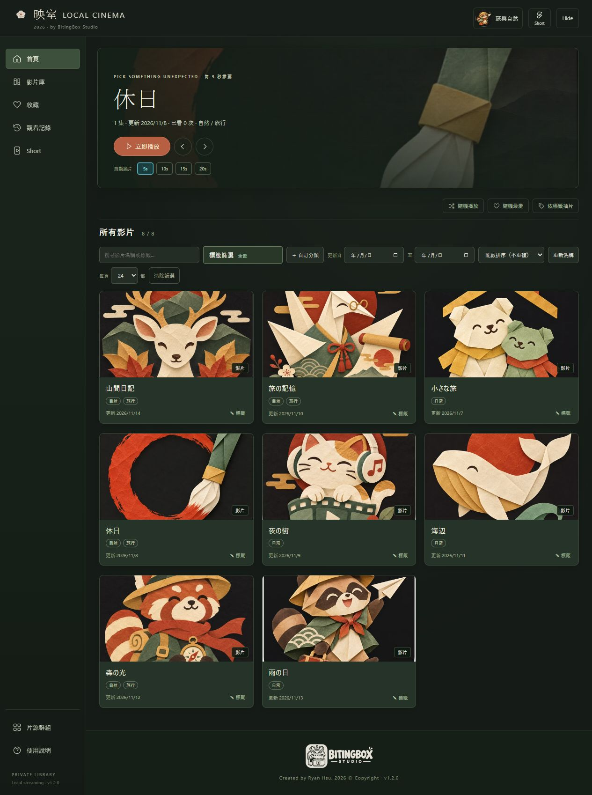
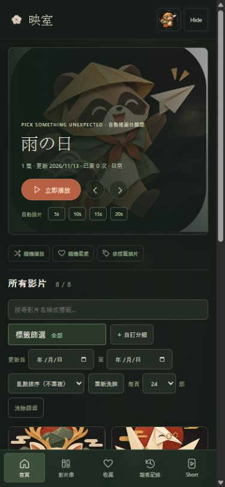
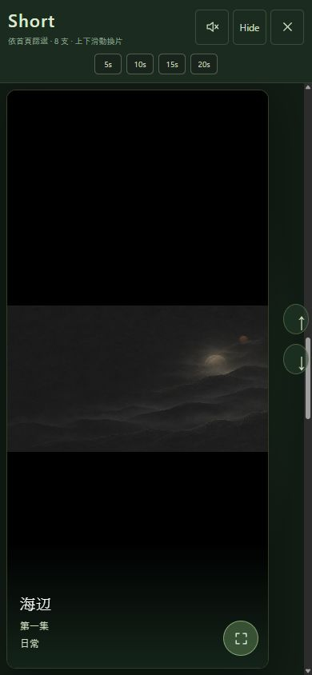
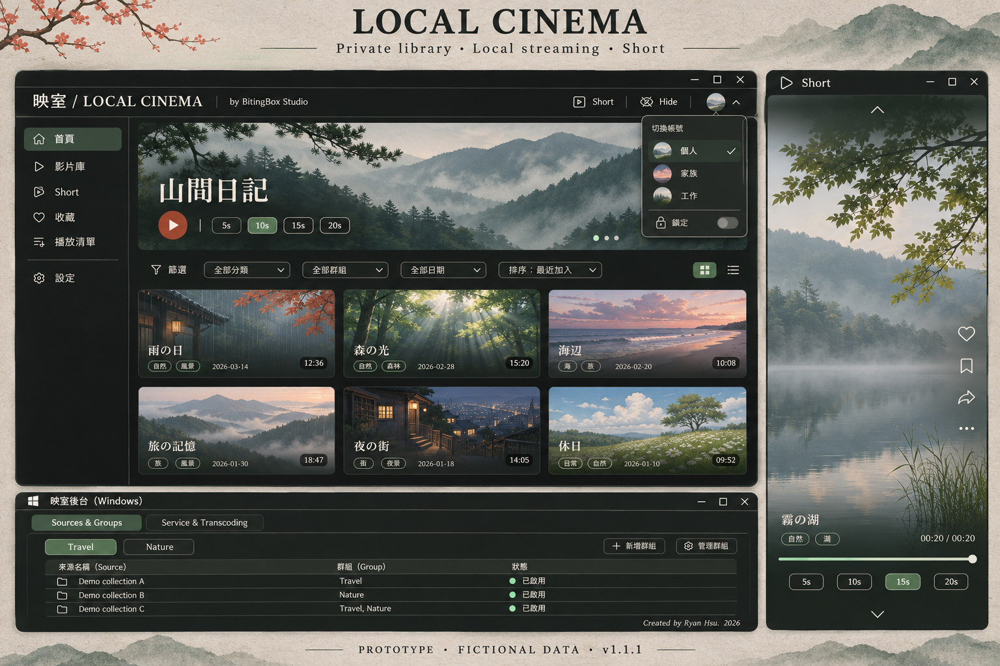
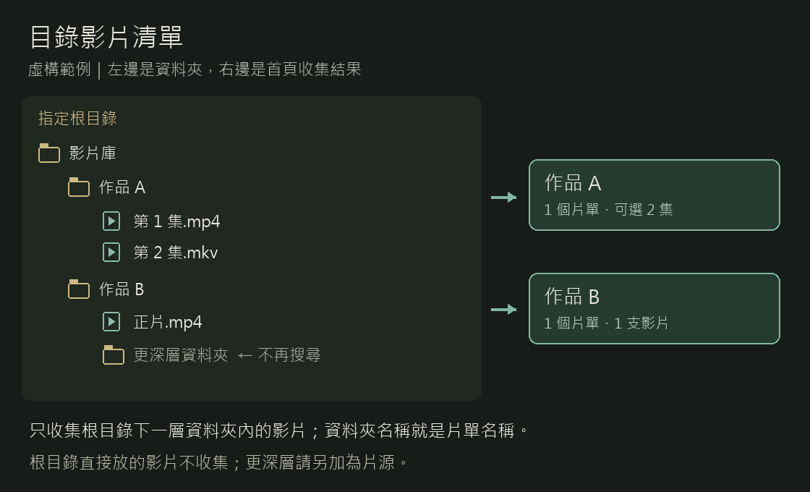
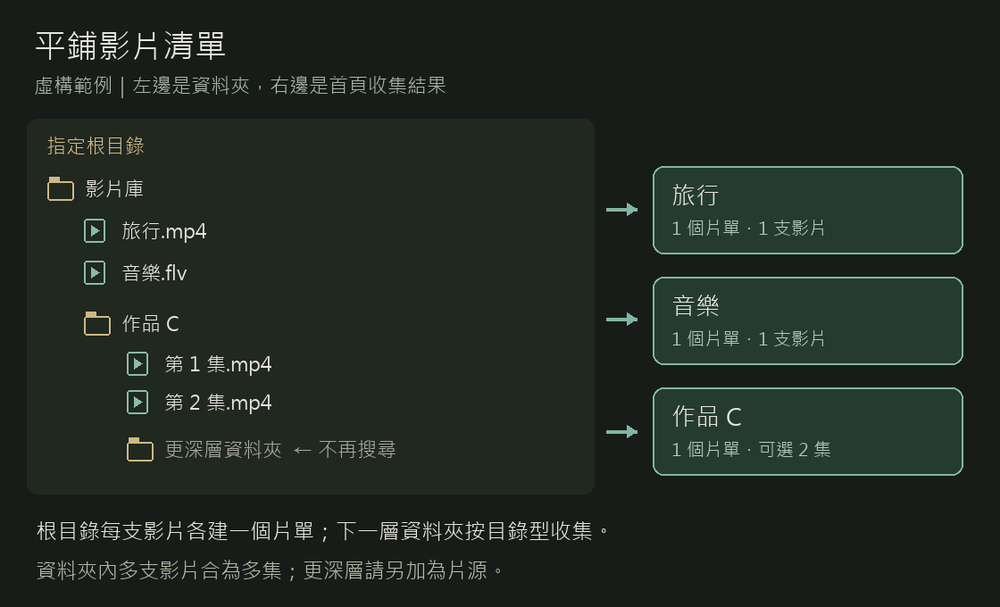

# 映室 LocalCinema

**Windows 私人影音庫｜v1.2.0**
Created by Ryan Hsu. 2026 © Copyright · BitingBox Studio

以暗色日系介面整理本機影片，從瀏覽器在本機或區網觀看。Windows 後台負責片源、掃描與轉檔，可縮至系統列持續運行。

## 新版實際介面



以上為實際程式使用隔離、虛構片單的畫面。封面使用專案預設插畫示範，沒有讀取個人片庫。

| 手機片庫 | Short 模式 |
|---|---|
|  |  |

<details>
<summary>最初的 AI prototype 設計參考</summary>



AI 生成的概念插圖，全部使用虛構內容，不是實際程式截圖。v1.2.0 已將其深綠側邊導覽、Banner 與卡片風格落實到程式；未加入圖中僅作示意且尚未實作的分享等控件。完整提示詞見 docs/images/prototype-prompt.json。

</details>

## 功能

- 多根目錄與片源群組，支援群組拖曳排序、自訂代表圖、30 款預設分類頭像。
- 隱藏頻道與密碼解鎖；未解鎖的頻道不提供清單、代表圖與直接播放存取。
- 各群組獨立分類與影片標籤，支援包含／排除複選、搜尋、日期、分頁與亂數排序。
- 推薦 Banner、收藏、觀看記錄、續播與多個手動關鍵幀。
- 影片預覽、時間軸預覽、多集切換、全螢幕、倍速、音量及滑動顯示控件。
- Short 捲動看片、按住畫面拖曳進退，以及 5／10／15／20 秒自動換片。
- 背景預先轉檔；人工確認後保存 MP4、驗證副本，再將原檔移至回收筒。
- 隱蔽毛玻璃、Hide 快速暫停／靜音／隱藏、單一執行與系統列控制。

## 開始使用

目前儲存庫提供原始碼；Windows 安裝檔未提交到 Git。若有發行安裝包，請由本儲存庫的 [Releases](https://github.com/RyanXuwei/LocalCinema/releases) 取得，勿將原始碼 ZIP 視為安裝程式。

### 從原始碼啟動

目標平台為 Windows 10／11 x64；目前開發與封裝使用 Windows 11、Python 3.12。

```powershell
py -3.12 -m venv .venv
.\.venv\Scripts\python.exe -m pip install -r requirements.txt
.\.venv\Scripts\pythonw.exe LocalCinema.pyw
```

也可使用 `安裝套件.cmd` 安裝依賴，但請確認它使用的是你要執行程式的 Python 環境。`建立啟動捷徑.pyw` 可為原始碼版建立捷徑。

1. 在「片源與群組」建立群組，於該群組加入目錄影片清單或平鋪影片清單。
2. 到「服務與轉檔」按「啟動」，按後台顯示的本機或區網連結開啟網頁。程式不會自動打開瀏覽器。
3. 片源變更後在後台重新掃描，前端沒有更新片庫按鈕。
4. 視窗 X 會先提醒，再縮至系統列；要完整退出請選「結束程式」或系統列「結束」。

預設連接埠為 `8765`，被占用時改用可用連接埠，請以後台實際連結為準。區網觀看需要裝置可以連到主機，以及 Windows 防火牆允許；程式不會自行修改防火牆。

## 兩種片單收集方式

| 方式 | 根目錄直接放的影片 | 下一層資料夾 | 更深層 |
|---|---|---|---|
| 目錄影片清單 | 不收集 | 一夾一片單，夾內多支合為多集 | 不再搜尋 |
| 平鋪影片清單 | 每支各建片單，以檔名命名 | 按目錄方式收集，可合為多集 | 不再搜尋 |

已另設為平鋪片源的子資料夾優先接管，避免被父層重複當成片單。更深層請另加片源。目錄片單使用夾內圖片；平鋪影片依檔名比對圖片，可部分涵蓋；沒有圖片則擷取影片畫面。




## 隱藏頻道

後台「新增／管理片源群組」選取群組，開啟「隱藏頻道／密碼」。前端片源選單右下角的小鎖頭可輸入密碼，解鎖後點亮，再按即可重鎖。

解鎖限目前瀏覽器工作階段，最多 8 小時；重啟後台或修改隱藏設定會撤銷授權。相同密碼的頻道會一起解鎖。這是瀏覽存取控制，**不是硬碟加密或獨立使用者帳號**。相同影片若也屬於公開群組，仍可由公開群組觀看。區網 HTTP 不提供傳輸加密，請使用可信任的網路，不要直接轉發到公網。

## 個人資料與更新

個人設定、SQLite、封面與轉檔快取位於：

```text
%LOCALAPPDATA%\LocalCinema  config.json
  library.sqlite3
  group-images  posters  playback```

更新不應覆蓋此目錄；完整結束程式後可自行備份整個資料夾。解除安裝不刪除個人資料。

正常退出會停止當前轉檔並清理未完成暫存檔；完成的快取保留。重啟並掃描後會重新排程，中斷的那支從頭轉檔。執行「保留 MP4 並回收原檔」時請等待完成，不要強制結束程序。

成功保存、驗證與回收後會移除完成的轉檔記錄，但保留影片識別對應，讓原片單、收藏、觀看進度、標籤與關鍵幀繼續對應。回收失敗的項目保留供重試。

## 詳細操作

### 群組與代表圖

群組是首頁片單的最上層切割範圍。後台「片源與群組」上方的「＋ 新增／管理片源群組」可新增、改名、拖曳排序、設定隱藏頻道、選用預設頭像或指定自己的代表圖。預設群組可改名但不能刪除，其他群組需先移走根目錄才能刪除。

後台每個群組都有獨立目錄分頁；新增來源直接加入目前分頁。要移動來源，先選取目錄（支援 Ctrl／Shift 複選），在選取列按右鍵 → 移動至群組。目錄設定變更後，到「服務與轉檔」重新掃描。群組數字是設定的根目錄數，前端頭像選單顯示的則是作品數。

### 分類、包含與排除標籤

「自訂分類」先建立該群組可用的標籤，尚未套用到影片也會顯示在篩選器。影片卡片的「標籤」與播放器快速標籤面板，點亮即套用；可一次套用多個。

- 包含標籤：符合任一選取項目即可（OR）。
- 排除標籤：只要命中任一項就排除；同時包含與排除時，排除優先。
- 空選項不限制，並可併用文字搜尋、更新日期、收藏／觀看範圍及排序。
- 換群組會清空當前搜尋、日期與標籤篩選，避免殘留條件令清單看似消失。
- 自訂分類、影片套用標籤及篩選選項皆以群組隔離；收藏與觀看記錄不等於獨立帳號資料。

### 首頁推薦、分頁與亂數

首頁推薦依觀看與曝光資料平衡較少出現的作品，不是機器學習推薦。Banner 可切換 5／10／15／20 秒輪播，支援左右滑動與上一個／下一個。片單預設每頁 24 部、穩定亂數排序；頁面內亂數不重複，變更範圍後依當前片單顯示。

可隨機播放目前篩選結果、其中的收藏，或先設定標籤再抽片。隨機片單與自動續集是互斥模式，可依需要全部關閉。

### 播放器與預覽

卡片停留約 3 秒啟動靜音預覽；主播放器時間軸停留約 0.5 秒可看預覽畫面。多集按鈕橫列顯示，停留可預覽該集與標題。點影片嘗試進全螢幕，但瀏覽器仍可能要求使用者操作，必要時點全螢幕按鈕。

桌面版左側提供首頁、影片庫、收藏、觀看記錄與 Short，窄螢幕改為底部導覽。單頁片單不顯示多餘分頁控件。

控件在互動時滑入顯示。支援倍速與直式音量選單、三階段亮度切換、收藏、標籤、上一集／下一集、關鍵幀及兩種播畢模式。

| 操作 | 行為 |
|---|---|
| Space 或 K | 播放／暫停 |
| ←／J、→／L | 倒轉／快進 10 秒 |
| ↑、↓ | 音量增減 |
| M | 靜音切換 |
| F | 全螢幕切換 |
| [、] | 降低／提高播放倍速 |
| -、+ 或 = | 三階段亮度切換 |
| 按住畫面左右拖動 | 時間軸進退；Shift 可細調 |
| 雙擊左／右三分之一 | 倒轉／快進 10 秒 |
| 雙擊中央 | 全螢幕切換 |
| 滾輪／Shift＋滾輪 | 音量／進退時間 |

快捷鍵在播放器開啟且焦點不在輸入控件時使用；播放器問號可查看操作說明。關鍵幀可加入目前時間或手動指定時間與名稱，點選即可跳播，依影片與集數分開保存。

### Short 捲動模式

先在首頁選群組、收藏範圍、標籤、搜尋或日期，再開啟 Short，即以該篩選片單建立捲動佇列。可見影片自動播放，離開項目停止並釋放；預設靜音，可自行取消。

上下滑換片，或使用上一部／下一部與方向鍵。按住畫面左右拖動仍可快進倒轉；點放大可進入完整播放器，返回後繼續 Short。可點亮 5／10／15／20 秒自動換片；重複點目前間隔可關閉，並在播放、非拖曳狀態下計時。

### 背景轉檔與人工確認

開啟後台「背景預先轉檔」，掃描後收集非原生格式並一次處理一支。此開關暫停後續背景排程；不是將正在處理的影片保存成可續傳分段。影片能否直接播放仍取決於容器與實際編碼，副檔名為 MP4 不代表所有瀏覽器都支援其中編碼。

在「轉檔記錄／人工檢查」：

1. 選取成品，按「開啟成品檢查」，確認畫面、聲音及內容；外部播放器不套用網頁毛玻璃。
2. 按「標記已確認」，這一步只確認，不回收原檔。
3. 選取已確認項目，按「保留 MP4 並回收原檔」，確認後由背景逐筆保存、驗證及回收。
4. 底部會顯示完成／失敗數。成功項目移出待辦，未完成項目保留。

MP4 保存至來源資料夾，不覆蓋同名檔案；原檔只送回收筒，不永久刪除。程式不自動清空回收筒。已完成轉換的快取與識別對應仍可保留，清除待辦不代表清除快取。

### 隱蔽與 Hide

後台勾選「隱蔽」會同步為影片、封面及預覽加毛玻璃，片源頭像保持清楚。Hide 只出現在首頁及播放器等主要操作區，用於快速暫停、靜音與隱藏畫面內容；兩者不能代替頻道密碼或硬碟存取權限。

## 常見問題

| 狀況 | 檢查方式 |
|---|---|
| 更新後仍是舊介面 | 完整退出後台再安裝，網頁按 Ctrl＋F5；不要只關 X |
| 新加入目錄沒出現 | 確認所選群組、目錄模式與一層搜尋邊界，再從後台重新掃描 |
| 清單突然空白 | 檢查群組、日期、搜尋及排除標籤；隱藏頻道需重新解鎖 |
| 區網裝置無法連線 | 使用後台實際區網連結，確認同網段、私用網路防火牆及主機仍在運行 |
| 出現多個區網 IP | 可能有多張實體／虛擬網卡；選裝置能連到的主機區網位址 |
| 格式無法直接播放 | 使用相容播放檔；損壞、受保護或缺少編碼器的來源不保證可轉換 |
| 原檔回收失敗 | 保留來源與已保存的 MP4，關閉正在使用原檔的播放器後重試 |
| 轉檔中想更新 | 使用「結束程式」正常退出；中斷的那支下次從頭處理。保存／回收批次須等完成 |
| 程式缺元件 | 原始碼版依 requirements 安裝；安裝版重新執行完整安裝包修復，不要單獨移動 EXE |

## 開發與維護

- [AGENTS.md](AGENTS.md)：AI 與自動化修改前必讀；[目前交接狀態](docs/AI_CONTEXT.md)。
- [架構](docs/ARCHITECTURE.md)、[資料與遷移](docs/DATA_MODEL.md)、[安全邊界](docs/SECURITY.md)。
- [開發、測試與 Windows 打包](docs/DEVELOPMENT.md)。
- [版本紀錄](CHANGELOG.md)、[素材與授權](docs/ASSETS_AND_LICENSES.md)。

測試僅使用合成資料；實機 UI、瀏覽器與裝置操作的驗證範圍必須分開說明。Short 已做合成捲動模型回歸測試，並於隔離瀏覽器以虛構片單檢查換片、載入與清理；尚未完成所有瀏覽器及實體手機的相容性驗證。

## 授權與署名

程式採用儲存庫既有的 [MIT License](LICENSE)。第三方元件保留各自授權，參見 [licenses](licenses)；FFmpeg 是獨立程序，所附授權資料顯示使用 GPL 組建。MIT 不授予 BitingBox Studio 名稱與 Logo 的商標權；品牌素材的使用範圍另見[素材說明](docs/ASSETS_AND_LICENSES.md)。
